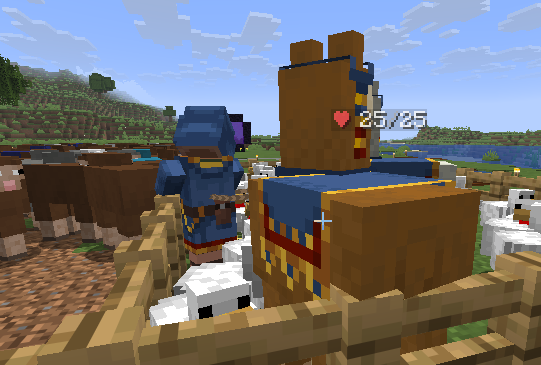
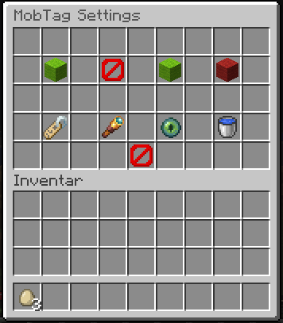
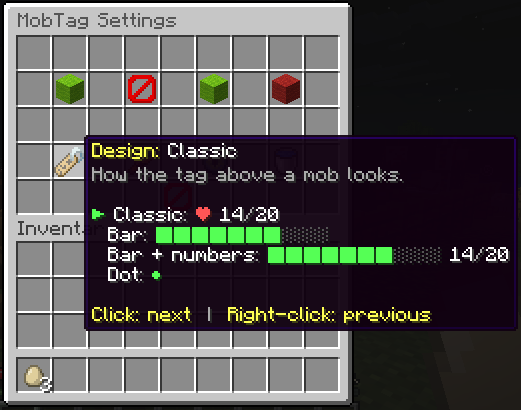

# MobTag (TechnikWeber fork)

<p>
  <a href="https://github.com/TechnikWeber/MobTag/releases/latest"></a>
  
  <a href="https://github.com/TechnikWeber/MobTag/actions/workflows/build.yml"></a>
  
  
  <a href="LICENSE"></a>
</p>

<p>
  <a href="https://github.com/Abood8001/MobTag"><b>Upstream project</b></a> &nbsp;·&nbsp;
  <a href="https://github.com/Abood8001/MobTag#readme"><b>Full documentation</b></a> &nbsp;·&nbsp;
  <a href="src/main/resources/config.yml"><b>Configuration</b></a>
</p>

Health tags above mobs for Paper/Spigot servers, shown to Java players and to Bedrock players
joining through Geyser/Floodgate.

This is a fork of [MobTag by Abood8001](https://github.com/Abood8001/MobTag), maintained for a
small Java + Bedrock crossplay server. Goals of the fork:

- keep it running on current Paper releases (26.x) alongside Geyser, Floodgate and ViaVersion
- tune how the tags look, on Java and on Bedrock
- send useful fixes back upstream

<p align="center">
  
</p>

## What the fork adds

- **Designs per player** in `/mobtag`: Classic, Bar, Bar + numbers, Dot (one green/yellow/red dot).
  Each design can have its own scale and opacity.
  Server owners define their own under `styles:` in `config.yml`.
- **Sizes per player**: small / medium / large (Java only, Bedrock keeps the normal size).
- **When to show, per player**: always, only the mob you look at, or only mobs you fight.
- **Duration per player**: in combat mode a tag stays 5, 10, 15 or 30 s after your last hit.
- **Target bar**: a boss bar with the mob you look at or fight, identical on Java and Bedrock.
- Passive mobs (cows, sheep, …) are hidden by default.
- Same choices as commands: `/mobtag style|size|show|duration <value>`, `/mobtag toggle targetbar`.
- Config updates keep every comment: new options land in their documented place, the old
  file is kept as `config.yml.v<N>.bak`.

Defaults for new players: Classic design, medium size, tags only on mobs you recently hit,
target bar off. Players change this in `/mobtag`, server owners in `config.yml`.

<p align="center">
  
  
</p>

Per-player designs and sizes need [PacketEvents](https://modrinth.com/plugin/packetevents); without
it everyone sees `default-style`.

## Features

- Health tag with bar and colour gradient above every mob in range, per player
- Two backends: packet-based text displays (with PacketEvents) or invisible armor stands
- Visibility modes `ALL`, `DAMAGER`, `LOOKING_AT`; optional damage indicators
- Bedrock players detected via Floodgate, with their own height offsets
- PlaceholderAPI, MythicMobs and MiniMessage support, in-game menu at `/mobtag`

Commands, permissions, placeholders and every config option are documented in the
[upstream README](https://github.com/Abood8001/MobTag#readme) and inline in
[`config.yml`](src/main/resources/config.yml).

## Install

1. Download `MobTag-x.y.z.jar` from the build artifacts or a release.
2. Put it into `plugins/`, optionally together with
   [PacketEvents](https://modrinth.com/plugin/packetevents).
3. Start the server, adjust `plugins/MobTag/config.yml`, run `/mobtag admin reload`.

## Build

JDK 17+ and Maven:

```bash
mvn clean package   # -> target/MobTag-x.y.z.jar
```

## License

MIT, see [LICENSE](LICENSE). Original work © Abood8001.
